<picture>
  <source media="(prefers-color-scheme: dark)" srcset="./public/readme/hunter-dark.svg" />
  
</picture>

**Railly Hugo** aka `Hunter` 
Software Engineer at ▲ Vercel Labs · Founder of ꕤ Crafter Station

I build at the frontier of what agents and interfaces can do.

**What I've been working on**

&nbsp;**[Petdex](https://www.railly.dev/work/petdex)**: animated pets for your coding agent 
&nbsp;**[Makeables](https://makeables.dev)**: cards, badges and stickers that feel like you

<!-- START:PROJECTS --><a href="https://www.railly.dev/work/petdex">Petdex</a>&nbsp;&nbsp;·&nbsp;&nbsp;<a href="https://agent-browser.dev">agent-browser</a>&nbsp;&nbsp;·&nbsp;&nbsp;<a href="https://issue-graph.dev">issue-graph</a>&nbsp;&nbsp;·&nbsp;&nbsp;<a href="https://dotframe.crafter.games">dotframe</a>&nbsp;&nbsp;·&nbsp;&nbsp;<a href="https://makeables.dev">Makeables</a><!-- END:PROJECTS -->

Latest: <!-- START:WRITING --><a href="https://www.railly.dev/blog/agentic-second-brain-four-months-later/">My Agentic Second Brain, Four Months Later</a><!-- END:WRITING -->

<a href="https://railly.dev">railly.dev</a> · <a href="https://x.com/raillyhugo">x</a> · <a href="https://www.youtube.com/@raillydev">youtube</a> · <a href="mailto:hi@railly.dev">email</a>

