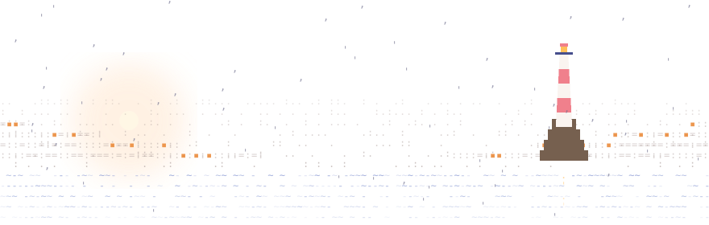

<picture>
  <source media="(prefers-color-scheme: dark)" srcset="./public/readme/garua-dark.svg" />
  
</picture>

I build at the frontier of what agents and interfaces can do. Peruvian engineer at [Vercel Labs](https://vercel.com/labs), founder of [Crafter Station](https://crafter.run).

<!-- START:PROJECTS -->[Petdex](https://www.railly.dev/work/petdex) · [agent-browser](https://agent-browser.dev) · [issue-graph](https://issue-graph.dev) · [dotframe](https://dotframe.crafter.games) · [Makeables](https://makeables.dev)<!-- END:PROJECTS -->

Notes: <!-- START:WRITING -->[My Agentic Second Brain, Four Months Later](https://www.railly.dev/blog/agentic-second-brain-four-months-later/) · [webctl: reverse-engineer any website into an agent CLI](https://www.railly.dev/blog/webctl/)<!-- END:WRITING -->

[railly.dev](https://railly.dev) · [x](https://x.com/raillyhugo) · [youtube](https://www.youtube.com/@raillydev)
